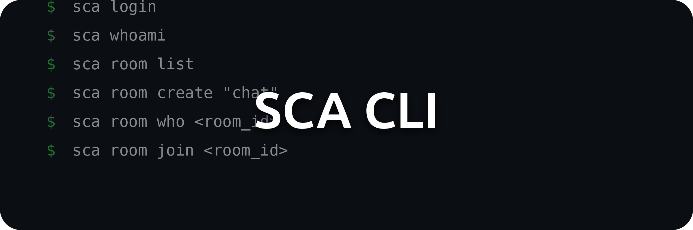

<div align="center">

<p align="center">
  
</p>

<p align="center"><a href="README.md">English</a> | <b>日本語</b></p>

<h1 align="center">SCA CLI</h1>

<h3 align="center">ブラウザを開かず、ターミナルからチャットする。</h3>

<p align="center"><code>https://chatapp.lapius7.com/</code> のチャット機能を、<code>sca</code> コマンドで使う CLI です。ルームの作成、一覧、入室、オンライン表示ができます。</p>

<p align="center">
  <a href="https://github.com/Lapius7/sca-cli/releases"></a>
  <a href="https://www.npmjs.com/package/@lapius/sca-cli"></a>
  <a href="LICENSE"></a>
  <a href="https://go.dev"></a>
  <a href="https://github.com/Lapius7/sca-cli/stargazers"></a>
  <a href="https://github.com/Lapius7/sca-cli/commits/main"></a>
</p>

<p align="center">
  <a href="#クイックスタート">クイックスタート</a> ·
  <a href="#コマンド">コマンド</a> ·
  <a href="#設計メモ">設計メモ</a> ·
  <a href="#既知の制約">既知の制約</a>
</p>

</div>

---

## 特長

- **ルーム**: 自分が作成したルームの一覧、作成、リネーム、削除。
- **オンライン表示**: 今そのルームにいる人を表示（`sca room who`）。
- **対話チャット**: ルームに入り、ターミナルでチャット（`sca room join`）。
- **ブラウザでログイン**: account.lapius7.com（Lapount）の SSO を使う。設定ファイルは不要。
- **鍵を持たない**: CLI は `ANON_KEY` を持たず、専用のリバースプロキシ経由で通信する。

## 構成

- `cli/`: 本体。ログイン（account.lapius7.com の SSO をブラウザ経由で利用）、ルームの一覧・作成・リネーム、REST API 呼び出し全般を担当。Go 標準ライブラリのみで、依存パッケージはなし。
- `realtime/`: Realtime（オンライン一覧・対話チャット）専用の内部ヘルパー。Supabase Realtime の WebSocket（Presence）プロトコルは公式 Python パッケージ（`supabase` / `realtime`）に頼るため、この部分だけ Python で実装し、Go 側からサブプロセスとして呼び出す。

直接使うのは `cli/` 側のバイナリ（`sca`）だけです。Python 側は `sca room who` / `sca room join` の実行時に裏で自動的に呼ばれます。

## クイックスタート

**1. インストール**

pnpm（推奨）:

```sh
pnpm add -g @lapius/sca-cli
```

Linux / macOS（x64・arm64）/ Windows（x64）のビルド済みバイナリが入ります。Go は不要で、Node.js 18 以降が必要です。更新も同じコマンドで行います。

> [!IMPORTANT]
> このパッケージは **pnpm 前提**です。npm と pnpm の両方に入れると同じコマンドが二重になるため、`pnpm add -g` だけを使ってください。

`sca room who` / `sca room join`（Realtime 機能）だけは Python 3 を使います。必要な Python 環境は初回実行時に自動で準備されます。

インストーラースクリプト（Go でソースからビルド）:

```sh
curl -fsSL https://raw.githubusercontent.com/Lapius7/sca-cli/main/install.sh | bash
```

Go が必要です。Go の有無チェック、ビルド、インストール先と PATH の案内、Realtime 用の Python 環境の準備までをまとめて行います。`go install` を直接叩く方法はサポートしません。

**2. ログイン**

```sh
sca login         # ブラウザで account.lapius7.com（Lapount）にログインし、自動的にセッションを取得する
```

これだけで使い始められます。設定ファイルを書く必要はありません。Realtime 機能に必要な Python 環境はインストーラースクリプトが自動で準備します。準備前に初めて `sca room who` / `sca room join` を実行した場合も、その場で自動的にセットアップされます。

## コマンド

```sh
sca whoami                                          # ログイン中のユーザーを表示
sca room list                                       # 自分が作成したルームの一覧（IDも表示される）
sca room create "雑談部屋"                           # ルーム作成（作成後そのまま入室する）
sca room rename 5f2e...-uuid "雑談部屋2"             # リネーム（自分が作成したルームのみ）
sca room delete 5f2e...-uuid                        # 削除（自分が作成したルームのみ、確認あり）
sca room who 5f2e...-uuid                           # 今そのルームにいる人を表示
sca room join 5f2e...-uuid                          # 入室して対話チャット開始
sca logout                                          # ログアウト
sca version                                         # バージョンを表示
```

`<room_id>` は**ルーム ID のみ**指定できます（名前では入室できません）。`chat_rooms` は全認証済みユーザーが SELECT できる RLS のため、名前検索を許すと、他人のルーム名を適当に打っただけで存在確認や ID の割り出し、入室ができてしまう問題がありました。そのため `sca room list` は自分が作成したルームだけを表示し、他人のルームへは作成者から `/invite` で渡された ID でのみ参加できるようにしています。

`sca room join` の対話セッション中は次のとおりです。

- 何か入力して Enter でメッセージ送信
- `/who` で現在のオンライン一覧
- `/invite` でこのルームへの招待方法（CLI コマンド・ブラウザ用 URL）を表示
- `/quit`・`/leave`・Ctrl+C で退室（退室しても DB には何も残らない。Web 版と同じ「切断するだけ」の挙動）

## 設定

通常は設定不要です。別の Supabase インスタンスに直接向けたい場合だけ、`~/.config/sca/config.env` に `SUPABASE_URL` / `ANON_KEY` を書くか、同名の環境変数を設定して上書きできます。この場合はプロキシを経由しないので、自分のインスタンスの `ANON_KEY` を指定する必要があります。

## 安全のために

> [!NOTE]
> CLI は supabase.lapius7.com に直接つながず、専用のリバースプロキシ `https://chatapp.lapius7.com/api/`（実体は `web/chatapp.lapius7.com/proxy/main.go`。REST / Auth / Realtime WebSocket をすべて中継する）経由で通信します。`ANON_KEY` の付与はこのプロキシだけが行うため、**CLI（Go / Python のどちら側にも）は `ANON_KEY` を一切持ちません**。`ANON_KEY` 自体は RLS で保護される前提の非秘匿な値（Web 版の JS バンドルにもそのまま入っている）なので、厳密には埋め込んでも問題ありません。ただ、CLI のソースコードに一切登場しない構成にして、「念のため」のリスクも無くしています。

<details>
<summary><code>sca login</code> の仕組み</summary>

`sca login` はローカルに一時 HTTP サーバー（OS に選ばせたランダムなポート）を立てます。まず `oauth-connect-token` 関数（action=mint。sca-proxy 経由なので `ANON_KEY` 不要）を呼んで、転送先（`http://127.0.0.1:<port>/callback`）に対応する使い捨てトークンを発行し、`https://account.lapius7.com/oauth/v2/authorize?token=<token>` を有効期限とともにターミナルに表示します。ブラウザは自動で開かないので、クリックまたはコピーして自分で開きます。account.lapius7.com の SSO ハンドオフでログインすると、そのローカルサーバーにトークンが自動的に返ってきます（`gh` / `aws` などの CLI と同じ方式）。`oauth-connect-token` の呼び出しと `/oauth/v2/authorize` へのアクセスは、sca-proxy を経由せず account.lapius7.com / supabase.lapius7.com に直接アクセスします。旧パス `/oauth/authorize` は account.lapius7.com 側で 302 リダイレクトされるので引き続き動きますが、新規のリンクは `/oauth/v2/authorize` で発行します。`/oauth/v2/authorize` は一般的な OAuth 認可エンドポイントの見た目に合わせた専用パスで、`chatapp.lapius7.com`・`post.lapius7.com`・`md.lapius7.com` などの既存サービスも同じ入口（と同じトークン発行の仕組み）を共有しています。実際の転送先 URL は URL に直接出ず、5 分で失効する使い捨てトークンの向こう側にあります。

ポートを固定（旧実装は `8765` 固定）にしなかったのは、固定ポートだと第三者が事前に同じポートを乗っ取っておき、フィッシングリンクでログインの確認画面だけ踏ませてセッションを奪うことが理論上可能になるためです（この CLI は OSS でポート番号も公開されている）。account.lapius7.com 側は `127.0.0.1` の任意ポートへのハンドオフだけを特例で許可しており（`oauth-connect-token` 関数・`sso-handoff` 関数・`ssoRedirect.ts`）、他ドメインへの緩和は一切行っていません。

</details>

## 設計メモ

<details>
<summary>設計メモ（サーバー側と内部実装）</summary>

- `chat`スキーマには「入室中/メンバー」を表す永続テーブルは無い。入退室はRealtime Presenceチャンネル(`room-<roomId>`)への接続/切断だけで表現される、Web版と全く同じ仕組み
- ルームの削除は作成者のみ可能(`chat.chat_rooms`のRLSに`created_by = auth.uid()`のDELETEポリシーを追加済み)。削除するとメッセージも`ON DELETE CASCADE`で一緒に消える(FK制約側で設定)。CLI(`sca room delete`)・Web版どちらも実行前に確認を挟む。メッセージ自体の編集/削除は引き続き未実装(RLSポリシー未対応)
- `config.env`と`session.json`のパス・形式はGo/Python両方で共有しているので、片方だけ書き換えるとズレる点に注意(基本はGo側の`sca login`だけがセッションを書く)
- 複数マシンにこのリポジトリをsyncthingで同期している場合、Python venvの場所が既定(`realtime/.venv`)と異なるなら`config.env`に`PYTHON_DIR=...`を追記する
- プロキシ本体(`web/chatapp.lapius7.com/proxy/`、このリポジトリの外側でVPS上にpm2常駐、nginxが`/api/`パスをこれにproxy_pass)は`net/http/httputil.ReverseProxy`だけで実装したシンプルなリバースプロキシ。REST/Auth/Realtime WebSocketいずれもsupabase.lapius7.comへの単純な中継で、`apikey`ヘッダーを必ず上書きする以外は何もしない。**`apikey`のクエリパラメータ付与は`/realtime/v1/websocket`パスだけに限定すること**(PostgRESTは未知のクエリパラメータを列フィルタとして解釈するため、全パスに付与すると認証成功時にPGRST100エラーで壊れる。この不具合は無効なトークンでのテストでは表面化せず、実トークンで初めて発覚した)
- `oauth-connect-token`関数(`web/supabase.lapius7.com/volumes/functions/oauth-connect-token/`)は`public.oauth_connect_tokens`テーブル(token/redirect_to/expires_at/used_at、RLS有効・ポリシー無しでservice_role以外アクセス不可)にmint/resolveする使い捨てトークンの発行所。redirect_toの妥当性チェックはmint時にここで行う(`sso-handoff`関数も独立して同じチェックをしており、多層防御になっている)。このSupabaseインスタンスは全Edge Functionに`VERIFY_JWT=true`がグローバル設定されている(関数ごとの個別設定は非対応)ため、呼び出し側は`apikey`とは別に`Authorization: Bearer <ANON_KEY以上の有効なJWT>`も必須。sca-proxyはAuthorizationヘッダーが無い場合だけANON_KEYを補うので、CLIはここでも何も送らなくてよい
- `/oauth/v2/authorize?token=...`のtokenが不正・期限切れ・使用済みの場合、`account.lapius7.com`はトップページへの無言リダイレクトではなく理由付きのエラー画面(`InvalidTokenScreen`)を表示する
- 確認画面(`AccountConfirm`)では、resolveで得た`expires_at`を1秒ごとに再計算する`ExpiryCountdown`でトークンの残り有効期限をライブ表示する(resolve自体はその場で使い捨てにするため、この表示は「本来あとどれくらいで無効になる想定だったか」を示すだけで、期限が来ても以降のログイン継続自体はブロックされない)
- Realtime機能のPython環境は`sca room who`/`join`実行時に自動セットアップされる(`ensurePythonReady`)。インストーラースクリプトもインストール直後に同じ処理を先回りして呼ぶので、通常はユーザーが手動でセットアップを意識する場面は無い(隠しコマンド`sca setup`で手動再実行も可能)。Python側は常にGitHubの`main`ブランチHEADから取得するが、以前は一度取得したら二度と更新しなかった(requirements.txtの有無しか見ていなかった)ため、`sca`本体だけタグ更新しても新しいPythonコードの変更(`/invite`追加等)が反映されない問題があった。ビルドに埋め込まれた`go install`のモジュールバージョン(`runtime/debug.ReadBuildInfo`)とキャッシュ側の記録を突き合わせ、ズレていたら再取得するようにしている
- `chat.py`の`on_message`は、送られてきたメッセージの`sender_id`が自分のuser_idと一致するかどうかだけで「CLIが送信したものだから表示しない(二重表示防止)」と判定していたが、これだと同じアカウントでブラウザからも送った場合にそのメッセージまで握り潰されてしまうバグがあった。現在はこのCLIセッションが実際に送信した内容だけを内容ベースの送信済みキュー(`ChatSession._pending_own`)で管理し、それ以外は自分のuser_idと一致していても表示する
- 退室(`/quit`等)・`sca room who`終了時、`supabase-auth`のトークン自動更新タイマーや`realtime`のpushタイムアウトなど、ライブラリ内部が自分では止めない裏タスクが残ったままイベントループを閉じると`Task was destroyed but it is pending!`という警告がstderrに出ることがあった(無害だが紛らわしい)。`realtime.close()`後に`asyncio.all_tasks()`で残っているタスクを明示的に`cancel()`してから終了するようにして解消した

</details>

## 既知の制約

- Presenceのキーはユーザー自身のuser_idなので、同じアカウントで複数のクライアント(CLI+ブラウザ等)を同時に開いても1人としてカウントされる(Web版と同じ仕様)
- `sca login`は`sca`を実行しているマシン自身でブラウザが開ける環境が前提(ローカルPC等)。SSH先のサーバー上でそのまま実行しても、ブラウザが手元のマシンで開いてもコールバックはSSH先に届かない。リモートで使う場合はターミナルに表示されるポート番号を確認して`ssh -L <そのポート>:localhost:<そのポート> ...`のようにポートフォワードすること(ポートは毎回ランダムなので、ログを見てから接続する必要がある)

> [!NOTE]
> この README は以前の文面を書き直し、コマンドを `cli/cmd/sca/main.go` と照合しました。この書き直しにあたって、CLI、プロキシ、Supabase の関数は実行していません。プロキシと Supabase の関数はこのリポジトリの外にあるため、サーバー側の記述は以前の README のまま、未確認で引き継いでいます。

## 開発

`v*` タグを push すると `.github/workflows/release.yml` が動き、npm への公開と GitHub Release へのバイナリ添付を行います。npm は Trusted Publisher 認証（トークンなし）です。`npm/build.mjs` が npm パッケージをビルドします。

## ライセンス

MIT
