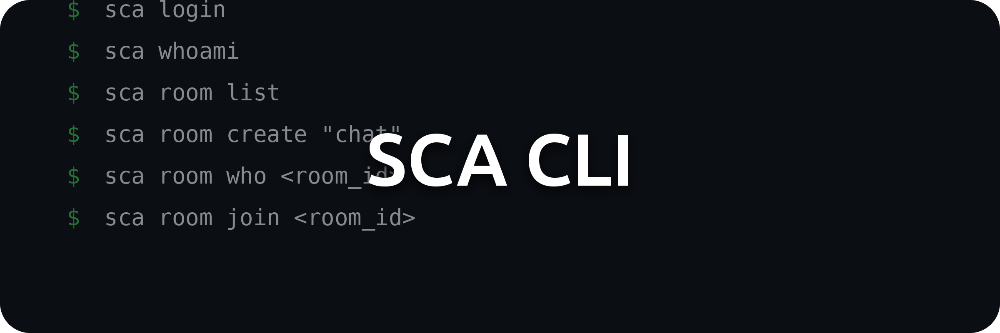

<div align="center">

<p align="center">
  
</p>

<p align="center"><b>English</b> | <a href="README.ja.md">日本語</a></p>

<h1 align="center">SCA CLI</h1>

<h3 align="center">Chat from the terminal, without opening a browser.</h3>

<p align="center">A CLI for the chat at <code>https://chatapp.lapius7.com/</code>. Create and list rooms, join them, and see who is online, all with the <code>sca</code> command.</p>

<p align="center">
  <a href="https://github.com/Lapius7/sca-cli/releases"></a>
  <a href="https://www.npmjs.com/package/@lapius/sca-cli"></a>
  <a href="LICENSE"></a>
  <a href="https://go.dev"></a>
  <a href="https://github.com/Lapius7/sca-cli/stargazers"></a>
  <a href="https://github.com/Lapius7/sca-cli/commits/main"></a>
</p>

<p align="center">
  <a href="#quick-start">Quick start</a> ·
  <a href="#commands">Commands</a> ·
  <a href="#design-notes">Design notes</a> ·
  <a href="#known-limitations">Known limitations</a>
</p>

</div>

---

## Features

- **Rooms**: list, create, rename, and delete rooms you created.
- **Online list**: see who is in a room now (`sca room who`).
- **Interactive chat**: join a room and chat in the terminal (`sca room join`).
- **Browser login**: sign in with account.lapius7.com (Lapount) SSO; no config file is needed.
- **No bundled key**: the CLI holds no `ANON_KEY`; it talks to a dedicated reverse proxy.

## Structure

- `cli/`: the main program. Login (using the account.lapius7.com SSO through the browser), room list/create/rename, and all REST API calls. Go standard library only, no dependencies.
- `realtime/`: an internal helper for Realtime (online list and interactive chat). The Supabase Realtime WebSocket (Presence) protocol relies on the official Python packages (`supabase` / `realtime`), so only this part is written in Python and the Go side calls it as a subprocess.

You use only the `sca` binary from `cli/`. The Python side runs behind the scenes for `sca room who` and `sca room join`.

## Quick start

**1. Install**

With pnpm (recommended):

```sh
pnpm add -g @lapius/sca-cli
```

This installs a prebuilt binary for Linux, macOS (x64, arm64), or Windows (x64). It needs no Go, only Node.js 18 or later. Run the same command to update.

> [!IMPORTANT]
> This package assumes **pnpm**. Installing with both npm and pnpm makes the same command appear twice, so use only `pnpm add -g`.

Only `sca room who` and `sca room join` (the Realtime features) use Python 3. The Python environment is prepared automatically on first run.

With the installer script (builds from source with Go):

```sh
curl -fsSL https://raw.githubusercontent.com/Lapius7/sca-cli/main/install.sh | bash
```

This needs Go. It checks for Go, builds, explains the install location and PATH, and prepares the Python environment for Realtime. Running `go install` directly is not supported.

**2. Log in**

```sh
sca login         # sign in to account.lapius7.com (Lapount) in the browser; the session is obtained automatically
```

That is all you need. You do not write a config file. The installer script prepares the Python environment for the Realtime features, and if you run `sca room who` or `sca room join` before that, it is set up on the spot.

## Commands

```sh
sca whoami                                          # show the logged-in user
sca room list                                       # rooms you created (IDs are shown)
sca room create "chat"                              # create a room (you enter it right after)
sca room rename 5f2e...-uuid "chat2"                # rename (only rooms you created)
sca room delete 5f2e...-uuid                        # delete (only rooms you created, asks first)
sca room who 5f2e...-uuid                           # show who is in the room now
sca room join 5f2e...-uuid                          # join and start interactive chat
sca logout                                          # log out
sca version                                         # show the version
```

A room is specified by **ID only**, not by name. `chat_rooms` is readable by every authenticated user under RLS, so allowing name lookup would let anyone check whether a room exists, find its ID, and enter it just by typing a guessed name. For that reason `sca room list` shows only the rooms you created, and other people's rooms can be joined only with an ID that the creator passes you with `/invite`.

During `sca room join`:

- Type text and press Enter to send a message.
- `/who` shows who is online.
- `/invite` shows how to invite someone to this room (the CLI command and a browser URL).
- `/quit`, `/leave`, or Ctrl+C leaves the room. Nothing remains in the database after you leave; it only disconnects, as on the web version.

## Configuration

Normally you need no configuration. To point the CLI directly at another Supabase instance, write `SUPABASE_URL` and `ANON_KEY` in `~/.config/sca/config.env`, or set environment variables with the same names. This skips the proxy, so you must give the `ANON_KEY` of your own instance.

## Safety

> [!NOTE]
> The CLI does not talk to supabase.lapius7.com directly. It goes through the reverse proxy `https://chatapp.lapius7.com/api/` (implemented in `web/chatapp.lapius7.com/proxy/main.go`, relaying REST, Auth, and the Realtime WebSocket). Only this proxy adds the `ANON_KEY`, so **neither the Go side nor the Python side of the CLI holds the `ANON_KEY`**. The `ANON_KEY` is a non-secret value that relies on RLS (it is in the web version's JS bundle as is), so embedding it would be acceptable in a strict sense, but keeping it out of the CLI source removes even that "just in case" risk.

<details>
<summary>How <code>sca login</code> works</summary>

`sca login` starts a temporary local HTTP server on a random port chosen by the OS. It first calls the `oauth-connect-token` function (action=mint; through sca-proxy, so no `ANON_KEY` is needed) to issue a one-time token for the redirect target (`http://127.0.0.1:<port>/callback`). It then prints `https://account.lapius7.com/oauth/v2/authorize?token=<token>` in the terminal with its expiry. The browser is not opened automatically; you click or copy the link. After you log in through the account.lapius7.com SSO handoff, the token returns to the local server automatically (the same method as CLIs such as `gh` and `aws`). The `oauth-connect-token` call and the `/oauth/v2/authorize` access go directly to account.lapius7.com and supabase.lapius7.com, not through sca-proxy. The old path `/oauth/authorize` is redirected with a 302 by account.lapius7.com and still works, but new links are issued with `/oauth/v2/authorize`. `/oauth/v2/authorize` is a dedicated path that looks like a common OAuth authorization endpoint; existing services such as `chatapp.lapius7.com`, `post.lapius7.com`, and `md.lapius7.com` share the same entry point and the same token mechanism. The real redirect URL does not appear in the URL; it sits behind a one-time token that expires in 5 minutes.

The port is not fixed (the old implementation used a fixed `8765`). With a fixed port, a third party could in theory take that port beforehand, make you open a phishing link that shows only the login confirmation screen, and steal the session (this CLI is open source and its port number is public). account.lapius7.com allows a handoff only to an arbitrary port on `127.0.0.1` as a special case (`oauth-connect-token` function, `sso-handoff` function, `ssoRedirect.ts`) and loosens nothing for other domains.

</details>

## Design notes

<details>
<summary>Design notes (server side and internals)</summary>

- The `chat` schema has no persistent table for "in the room" or members. Joining and leaving are expressed only by connecting to and disconnecting from the Realtime Presence channel (`room-<roomId>`), exactly as on the web version.
- Only the creator can delete a room (a DELETE policy with `created_by = auth.uid()` was added to the RLS of `chat.chat_rooms`). Deleting also removes its messages through `ON DELETE CASCADE` (set on the FK). Both the CLI (`sca room delete`) and the web version ask before deleting. Editing and deleting messages is still not implemented (no RLS policy).
- The paths and formats of `config.env` and `session.json` are shared by Go and Python, so changing only one side makes them drift. Normally only `sca login` on the Go side writes the session.
- If you sync this repository across machines with syncthing and the Python venv is not at the default location (`realtime/.venv`), add `PYTHON_DIR=...` to `config.env`.
- The proxy itself (`web/chatapp.lapius7.com/proxy/`, outside this repository, kept running by pm2 on a VPS, with nginx passing the `/api/` path to it) is a simple reverse proxy built only on `net/http/httputil.ReverseProxy`. REST, Auth, and the Realtime WebSocket are plain relays to supabase.lapius7.com, and it does nothing except always overwrite the `apikey` header. **Add the `apikey` query parameter only on the `/realtime/v1/websocket` path.** PostgREST treats unknown query parameters as column filters, so adding it to every path breaks authenticated requests with a PGRST100 error. This bug did not show up in tests with an invalid token and was found only with a real token.
- The `oauth-connect-token` function (`web/supabase.lapius7.com/volumes/functions/oauth-connect-token/`) issues one-time tokens by mint and resolve against the `public.oauth_connect_tokens` table (token, redirect_to, expires_at, used_at; RLS enabled with no policy, so only service_role can access it). It validates `redirect_to` at mint time (the `sso-handoff` function does the same check independently, for defense in depth). This Supabase instance sets `VERIFY_JWT=true` globally for all Edge Functions (per-function settings are not supported), so callers need an `Authorization: Bearer <a valid JWT at ANON_KEY level or above>` in addition to `apikey`. sca-proxy adds the `ANON_KEY` only when there is no Authorization header, so the CLI sends nothing here either.
- If the token in `/oauth/v2/authorize?token=...` is invalid, expired, or used, account.lapius7.com shows an error screen with the reason (`InvalidTokenScreen`) instead of a silent redirect to the top page.
- The confirmation screen (`AccountConfirm`) shows the token's remaining lifetime live with `ExpiryCountdown`, which recalculates the `expires_at` from resolve every second. Resolve consumes the token on the spot, so this only shows how long it was expected to stay valid; reaching the deadline does not block continuing the login.
- The Python environment for the Realtime features is set up automatically when you run `sca room who` or `sca room join` (`ensurePythonReady`). The installer script calls the same step right after installing, so you normally do not need to think about it (the hidden command `sca setup` re-runs it by hand). The Python side is always fetched from the HEAD of the GitHub `main` branch. It used to be fetched once and never updated (only the presence of `requirements.txt` was checked), so a tag update of `sca` alone did not bring new Python changes such as `/invite`. Now the module version embedded at build time by `go install` (`runtime/debug.ReadBuildInfo`) is compared with the cache record, and the code is fetched again when they differ.
- In `chat.py`, `on_message` used to hide a message only because its `sender_id` matched your user ID ("the CLI sent it, so do not show it again"). That also swallowed messages you sent from a browser with the same account. Now only content that this CLI session actually sent is tracked in a content-based sent queue (`ChatSession._pending_own`), and everything else is shown even if the user ID matches yours.
- When leaving (`/quit` and so on) or finishing `sca room who`, background tasks that libraries do not stop on their own (the `supabase-auth` token refresh timer, the `realtime` push timeout) could remain when the event loop closed, and a `Task was destroyed but it is pending!` warning could appear on stderr (harmless but confusing). After `realtime.close()`, the remaining tasks from `asyncio.all_tasks()` are now cancelled explicitly before exit.

</details>

## Known limitations

- The Presence key is your own user ID, so opening several clients (CLI and browser, for example) with the same account counts as one person, the same as the web version.
- `sca login` assumes you can open a browser on the machine that runs `sca` (a local PC and so on). If you run it on an SSH server and open the browser on your own machine, the callback does not reach the server. For remote use, check the port number printed in the terminal and forward it, for example `ssh -L <that port>:localhost:<that port> ...`. The port is random each time, so connect after you see the log.

> [!NOTE]
> This README was rewritten from the previous text, and the commands were checked against `cli/cmd/sca/main.go`. The CLI, the proxy, and the Supabase functions were not run for this rewrite. The proxy and the Supabase functions are outside this repository, so the server-side notes are carried over from the previous README without checking.

## Development

Pushing a `v*` tag runs `.github/workflows/release.yml`. It publishes to npm and attaches binaries to the GitHub Release, with npm Trusted Publisher authentication (no token). `npm/build.mjs` builds the npm package.

## License

MIT
